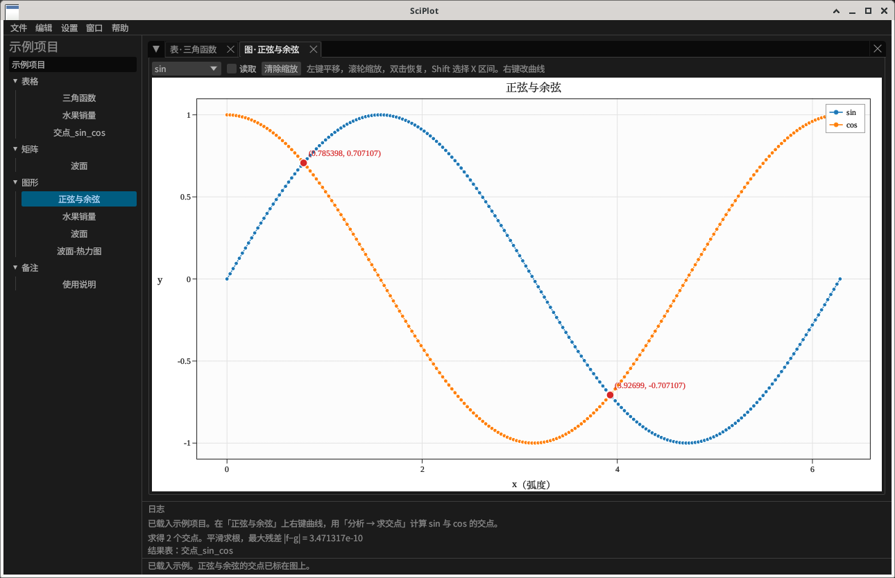
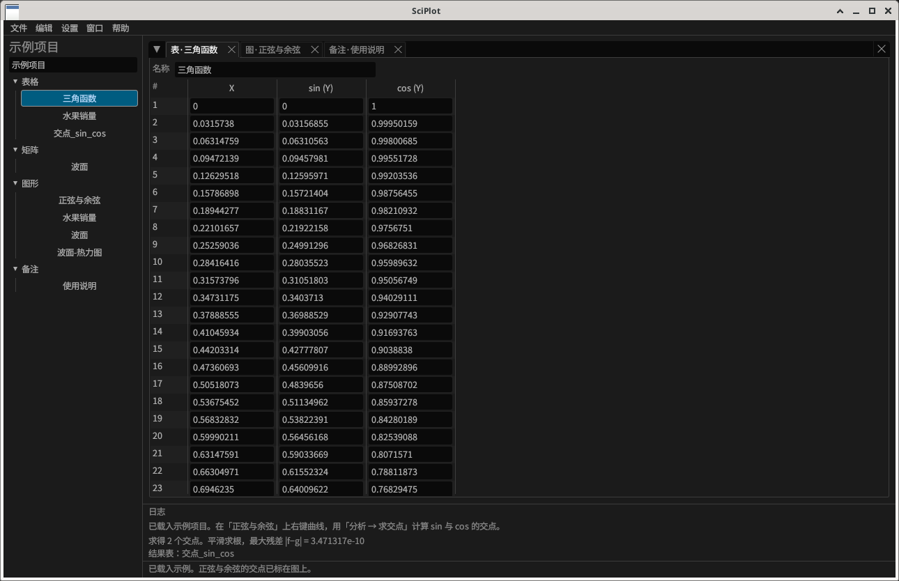

<p align="center">
  
</p>

<h1 align="center">SciPlot</h1>

<p align="center">
  用 Rust 编写的中文科学绘图桌面程序<br>
  界面对齐 <a href="https://scidavis.sourceforge.net/">SciDAVis</a>，原生支持中文
</p>

<p align="center">
  <a href="#下载">下载</a> ·
  <a href="#构建">构建</a> ·
  <a href="#主要功能">功能</a> ·
  <a href="https://github.com/pipidu/plot/releases">Releases</a>
</p>

在表格和矩阵里整理数据，画出多种二维图和三维曲面，做拟合与分析，还可以求曲线或折线的交点。图可以导出为 PNG 或 SVG，也可以复制到剪贴板。

<p align="center">
  
</p>

<p align="center"><sub>启动后会打开示例项目：正弦与余弦已经算出交点，标在图上，并写入表格「交点_sin_cos」。</sub></p>

## 下载

程序在 [GitHub Releases](https://github.com/pipidu/plot/releases)。官方以 Windows 为主，同时提供 Linux 包。每次推送到 `main` 都会编译并发布两个文件。当前最新版本是 [0.2.1-b7](https://github.com/pipidu/plot/releases/tag/v0.2.1-b7)：

| 文件 | 平台 | 说明 |
| --- | --- | --- |
| `sciplot-<版本>-b<构建号>-windows-x86_64.exe` | 64 位 Windows | 主要使用的版本。下载后双击运行，不需要安装。找不到微软雅黑时，会使用程序内嵌的中文字体。 |
| `sciplot-<版本>-b<构建号>-linux-x86_64` | 64 位 Linux | 需要图形界面（X11 或 Wayland）。动态链接构建机上的 glibc，较老的系统可能打不开。下载后加上可执行权限再运行，例如 `chmod +x sciplot-*-linux-x86_64`。 |

没有 macOS 包，也没有安装程序、AppImage 或发行版软件包。仓库地址是 <https://github.com/pipidu/plot>。程序里「帮助 → 关于」可以打开这个地址，也可以检查更新。

## 构建

需要 Rust 1.81 或更新的稳定版。

```bash
cargo run -p sciplot
cargo run -p sciplot -- 实验.splot
cargo test
```

直接写出项目路径就会打开那个 `.splot`，例如 `sciplot 实验.splot`。

不打开窗口、只导出示例图：

```bash
cargo run -p sciplot -- --export-demo target/demo
```

程序面向 Windows。在 Linux 上可以交叉编译：

```bash
rustup target add x86_64-pc-windows-gnu
sudo apt install mingw-w64
cargo build -p sciplot --release --target x86_64-pc-windows-gnu
```

生成的 `sciplot.exe` 不带控制台窗口。界面字体优先使用微软雅黑，找不到时使用程序内嵌的 Droid Sans Fallback。图上的英文和数字优先使用 Times New Roman，中文优先使用宋体；Linux 上分别回退到 Liberation Serif 和内嵌字体。设置里可以改成一个字体文件，界面和图都会用它。

在 Linux 上直接 `cargo run -p sciplot` 也可以。发布的 Linux 文件是动态链接的，不是静态打包；运行时要有图形会话。没有系统文件对话框时可以设置 `SCIPLOT_NO_DIALOG=1`，改在程序里输入路径。

界面默认是简体中文，可以在「设置 → 默认样式与字体」里改成英语。语言记在本机，不写进项目文件。已经写进表格和图里的文字不会跟着语言再翻译；重新打开示例项目会按当时的语言生成。

## 主要功能

- 项目树、可停靠的表格 / 矩阵 / 图形 / 备注窗口，撤销与重做，`.splot` 项目文件，最近文件。
- 右键操作：表格里插入或删除行列、改列公式、排序和绘图；矩阵里填充、转置和画热力图或三维图；图上点中一条线可以改属性、隐藏或删除，点图例上的名字可以重新显示，点空白处改坐标轴、图例和标注。菜单栏只保留文件、编辑、设置、窗口和帮助。
- 设置里可以选择界面语言（简体中文或英语），指定字体文件，并设定新建曲线的线宽、线型、符号，以及标题和坐标轴的字号。这些记在本机，不写进项目文件。
- 表格：增删行列，列角色（X/Y/Z/误差/标签），数值、文本、日期、时刻和日期时间，按列设置小数位和日期格式，列公式、单元格公式和 `tablecol`，排序（整表、所选列一起或分别），填充行号或随机数，归一化到 [0, 1]，列统计表和行统计，复制粘贴单元格，CSV 导入（分隔符、跳过行、小数点、多个文件）和导出（UTF-8 与 GBK）。
- 矩阵：公式填充、转置、求逆，与表格互转。
- 二维图：折线、散点、点线、阶梯、柱状、条形、直方图、面积、误差棒、箱线、饼图、向量场、热力图、等高线、函数曲线。
- 坐标轴可以是线性、对数或倒数，支持网格、图例、标题、曲线样式、文本和箭头标注。滚轮缩放，拖拽平移，双击恢复，Shift 拖拽选择 X 区间。
- 三维曲面、线框和散点。左键拖拽旋转，滚轮缩放，双击或「清除缩放」恢复默认视角。
- 分析：线性、多项式、指数、高斯、洛伦兹和自定义拟合，微分、积分、插值、平滑、FFT、滤波、相关。
- 导出 PNG（可设 DPI）、SVG，或复制到剪贴板。

<p align="center">
  
</p>

<p align="center"><sub>表格里编辑数据、设置列角色，也可以用列公式和 CSV 导入导出。</sub></p>

<p align="center">
  
</p>

<p align="center"><sub>三维曲面带坐标范围和色标，可以旋转、缩放，再恢复默认视角。</sub></p>

<p align="center">
  
</p>

<p align="center"><sub>拟合结果写成易读的公式，曲线画在图上；也可以先按住 Shift 拖出 X 区间，再只拟合这一段。</sub></p>

## 求交点

在图上右键一条曲线，选「分析 → 求交点…」。两条输入各自可以是数据曲线、函数曲线、拟合曲线、水平线 `y=c` 或竖直线 `x=c`。

- 分段模式把曲线看成折线，先用网格丢掉不相交的线段，再精确求交。曲线不必按 X 单调。
- 平滑模式对函数表达式直接求根；数据如果能按 X 排成严格递增，则先做三次样条，再用 Brent 法收束。
- 可以手填 X 区间，也可以先在图上按住 Shift 拖出区间，对话框会带上这个范围。
- 交点用标记画在图上，同时写入新表「交点_A_B」，并记入底部日志。

## 公式

列公式和拟合表达式用 evalexpr。`sin(col("X"))*2`、`col("A")`、`cell("A", 行号)`、`i`（从 1 开始的行号）都可以。`tablecol("表","列")` 读另一张表的同一行。某一格可以单独写公式；公式编辑模式在格子里显示公式。整数除法会截断，需要小数时写成 `1.0/2`。帮助菜单里有完整说明。

## 让 AI 画图

窗口开着时，SciPlot 在 `127.0.0.1` 上提供本机 API，只接受带令牌的请求。令牌和端口写在主目录的 `.sciplot_api.json`，退出时删除。开关和端口在「设置 → 默认样式与字体」里。AI 的改动可以撤销。

不打开窗口时：

```bash
sciplot --mcp
sciplot --mcp --project 实验.splot
```

窗口开着时，`--mcp` 把调用转给窗口；没开时在这个进程里改项目。带了 `--project` 才会在每次改动后写回文件。标准输出只写 MCP 协议。

Claude Desktop 或 Cursor：

```json
{
  "mcpServers": {
    "sciplot": {
      "command": "sciplot",
      "args": ["--mcp"]
    }
  }
}
```

Windows 上把 `command` 写成 `sciplot.exe` 的完整路径。帮助菜单里的「AI 接入…」也有这段说明。

## 快捷键

| 按键 | 作用 |
| --- | --- |
| Ctrl+N | 新建项目 |
| Ctrl+O | 打开 |
| Ctrl+S | 保存 |
| Ctrl+Z | 撤销 |
| Ctrl+Y | 重做 |
| Delete | 删除选中的标注 |
| Enter | 对话框里执行确定、计算或保存 |
| Esc | 关闭当前对话框 |

## 目录

- `crates/core`：表格、矩阵、项目、公式、CSV。
- `crates/analysis`：拟合、微积分、插值、平滑、FFT、统计、交点。
- `crates/plot`：坐标变换、图元、SVG 和 PNG。
- `crates/app`：egui 界面。
