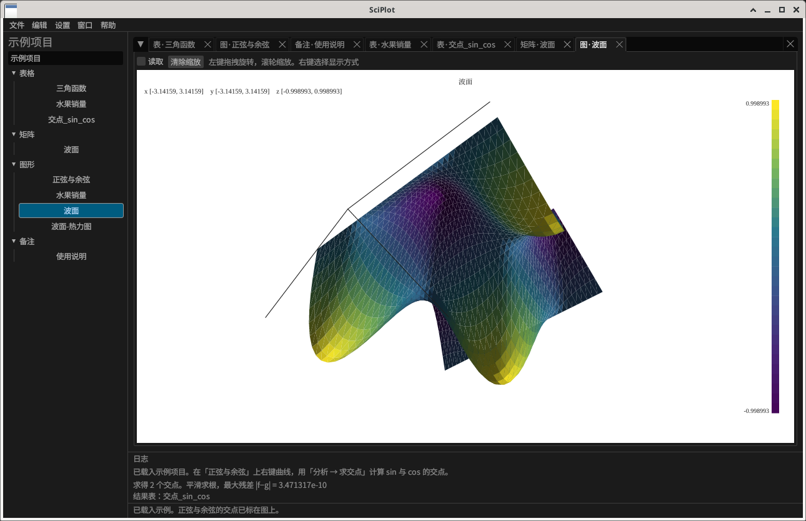
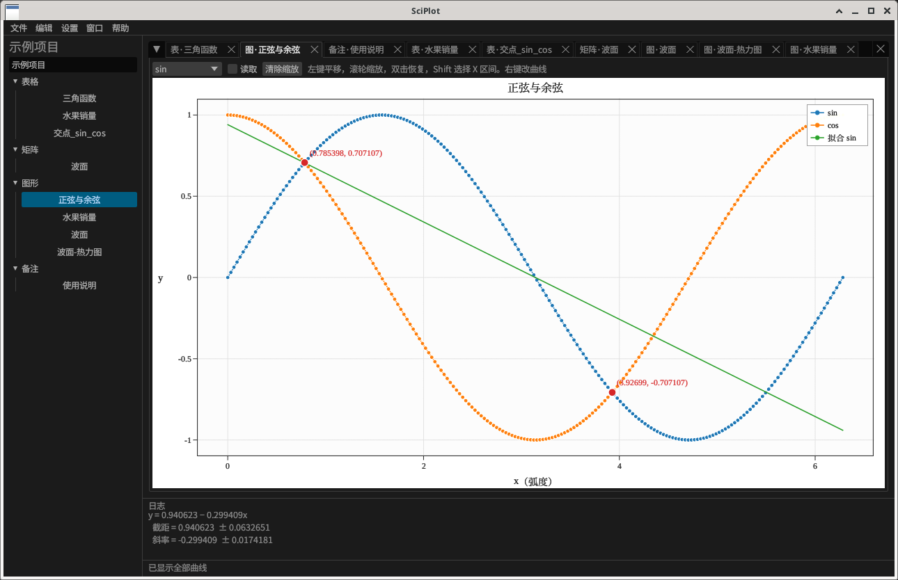

<p align="center">
  
</p>

<h1 align="center">SciPlot</h1>

<p align="center">
  用 Rust 编写的中文科学绘图桌面程序<br>
  界面对齐 <a href="https://scidavis.sourceforge.net/">SciDAVis</a>，原生支持中文
</p>

<p align="center">
  <a href="#下载">下载</a> ·
  <a href="#构建">构建</a> ·
  <a href="#主要功能">功能</a> ·
  <a href="https://github.com/pipidu/plot/releases">Releases</a>
</p>

在表格和矩阵里整理数据，画出多种二维图和三维曲面，做拟合与分析，还可以求曲线或折线的交点。图可以导出为 PNG、SVG、EPS、PDF、JPEG、BMP、PBM、PGM、PPM、XBM 或 XPM，也可以复制 PNG 或 SVG 到剪贴板。没有系统打印机时，「打印」会写成 PDF。

<p align="center">
  
</p>

<p align="center"><sub>启动后会打开示例项目：正弦与余弦已经算出交点，标在图上，并写入表格「交点_sin_cos」。</sub></p>

## 下载

程序在 [GitHub Releases](https://github.com/pipidu/plot/releases)。版本号是 0.2.1，构建号随每次推送到 `main` 增加。Windows 和 Linux 先发布；未签名的 macOS 应用随后附到同一个标签。

| 文件 | 平台 | 说明 |
| --- | --- | --- |
| `sciplot-<版本>-b<构建号>-windows-x86_64.exe` | 64 位 Windows | 下载后双击运行，不需要安装。找不到微软雅黑时，会使用程序内嵌的中文字体。 |
| `sciplot-<版本>-b<构建号>-linux-x86_64` | 64 位 Linux | 需要图形界面（X11 或 Wayland）。动态链接构建机上的 glibc，较老的系统可能打不开。下载后加上可执行权限再运行，例如 `chmod +x sciplot-*-linux-x86_64`。 |
| `sciplot-<版本>-b<构建号>-macos-aarch64.tar.gz` | Apple Silicon macOS | 未签名、未公证。解压后是 `SciPlot.app`，需要 macOS 11 或更新。CI 不编译 Intel 包；在 Intel Mac 上可以自己运行 `scripts/package-macos.sh`。 |

没有安装程序、AppImage 或发行版软件包。仓库地址是 <https://github.com/pipidu/plot>。程序里「帮助 → 关于」可以打开这个地址，也可以检查更新。

## 构建

需要 Rust 1.81 或更新的稳定版。

```bash
cargo run -p sciplot
cargo run -p sciplot -- 实验.splot
cargo test
```

直接写出项目路径就会打开那个 `.splot`，例如 `sciplot 实验.splot`。

不打开窗口、只导出示例图：

```bash
cargo run -p sciplot -- --export-demo target/demo
```

程序面向 Windows。在 Linux 上可以交叉编译：

```bash
rustup target add x86_64-pc-windows-gnu
sudo apt install mingw-w64
cargo build -p sciplot --release --target x86_64-pc-windows-gnu
```

生成的 `sciplot.exe` 不带控制台窗口。界面字体优先使用微软雅黑，找不到时使用程序内嵌的 Droid Sans Fallback。图上的英文和数字优先使用 Times New Roman，中文优先使用宋体；Linux 上分别回退到 Liberation Serif 和内嵌字体。设置里可以改成一个字体文件，界面和图都会用它。

在 Linux 上直接 `cargo run -p sciplot` 也可以。发布的 Linux 文件是动态链接的，不是静态打包；运行时要有图形会话。没有系统文件对话框时可以设置 `SCIPLOT_NO_DIALOG=1`，改在程序里输入路径。

界面默认是简体中文。可以在「设置 → 默认样式与字体」里改成英语、繁体中文、德语、法语、俄语、西班牙语、捷克语或巴西葡萄牙语。菜单和项目树会跟着翻译；带参数的状态句和长说明仍用英语。语言记在本机，不写进项目文件。已经写进表格和图里的文字不会跟着语言再翻译；重新打开示例项目会按当时的语言生成。

## 主要功能

- 项目树、可停靠的表格 / 矩阵 / 图形 / 备注窗口，撤销与重做，最近文件。项目里可以建文件夹和子文件夹，树可以按当前文件夹过滤，也可以包含子文件夹。
- 项目文件是未压缩的 `.splot`，也可以存成 `.splot.gz`。`.sciprj` 和 `.sciprj.gz` 能交换表格、矩阵、备注、文件夹和一部分曲线。一部分 Origin 项目（`.opj`、`.opju`、`.ogw`、`.ogg`、`.ogm`）可以打开数值列；图、文本列和分析不会导入，也不能写回 Origin。文件菜单可以追加另一个项目，而不是替换当前项目。
- 右键操作：表格里插入或删除行列、改列公式、排序和绘图；矩阵里填充、转置和画热力图或三维图；图上点中一条线可以改属性、隐藏或删除，点图例上的名字可以重新显示，点空白处改坐标轴、图例和标注。菜单栏是文件、编辑、脚本、设置、窗口和帮助。
- 设置里可以选择上面列出的界面语言，指定字体文件，并设定新建曲线的线宽、线型、符号，以及标题和坐标轴的字号。这些记在本机的 `.sciplot_prefs.json`，不写进项目文件。同一套默认样式可以另存为 `.spstyle` 再打开，里面没有语言和本机 API。`.spstyle` 不是图形模板。
- 表格：增删行列，列角色（X/Y/Z/误差/标签），数值、文本、日期、时刻和日期时间，按列设置小数位和日期格式，列公式、单元格公式和 `tablecol`，排序（整表、所选列一起或分别），填充行号或随机数，归一化到 [0, 1]，列统计表和行统计，复制粘贴单元格，CSV 导入（分隔符、跳过行、小数点、多个文件）和导出（UTF-8 与 GBK）。
- 矩阵：公式填充、转置、求逆，与表格互转。
- 二维图：折线、散点、点线、阶梯、柱状、条形、直方图、面积、误差棒、箱线、饼图、向量场、热力图、等高线、函数曲线。
- 坐标轴可以是线性、对数或倒数，支持网格、图例、标题、曲线样式、文本和箭头标注。滚轮缩放，拖拽平移，双击恢复，Shift 拖拽选择 X 区间。
- 一张图可以有多个图层。图窗口左上角的数字按钮切换当前图层。表格右键「面板」可以排成上下两层、左右两层、四层、堆叠图层或堆叠直方图。右键还可以复制图层、把另一张图插进来、按行列和边距排列，或改单个图层的位置。新建图层按接近正方形的网格排，不再只做上下均分。
- 三维：矩阵或 `z=f(x,y)` 的曲面、多边形、线框、隐藏线、网格曲面和散点（圆点、十字、锥体、竖线）。表格里选中一列可以画三维色带、三维柱或三维轨迹。文件菜单可以把图像导入成强度矩阵，或直接画成三维曲面。边长超过 160 的矩阵在三维显示时会抽稀，矩阵里的数不改。
- 分析：线性、多项式、指数（含一到三阶衰减和增长）、Boltzmann、高斯、洛伦兹、多峰和自定义拟合。可以选权重、容差、最大迭代和算法（缩放 / 不缩放 Levenberg–Marquardt、Nelder–Mead）。还有微分、积分、插值、平滑、FFT（含实部虚部、逆变换、归一化和零频移位）、低通 / 高通 / 带通 / 带阻、卷积、反卷积和信号相关。项目树上的「相关性」仍是列与列的 Pearson 相关。
- 导出当前图或项目里的全部图：PNG（可设 DPI，默认 144）、SVG、EPS、PDF、JPEG、BMP、PBM、PGM、PPM、XBM、XPM。可以选纸张（A3、A4、A5、信纸、法律用纸）、纵向或横向、JPEG 质量，以及 PNG / XPM / SVG 的透明背景。原来的「导出当前图形 PNG / SVG」和复制到剪贴板仍在。
- 文件菜单「打印…」和「打印全部图形…」弹出纸张、方向和分辨率。结果写成 PDF，每张图一页。本机没有打印机时，这个 PDF 就是打印结果。
- 「保存为模板…」写出 SciPlot 的 `.sptpl`。它记下画布大小、字体、颜色和文字标注，打开后是一张空图，再用「添加曲线」填数据。曲线样式和刻度不在模板里。这不是 SciDAVis 的 `.qpt`。
- 列公式仍用 evalexpr。`if()`、`?:` 和缩进的 `if / elif / else` 只计算被选中的一边。两个整数相除仍然截断。以 `python:` 开头的列公式用程序内的 Python 子集逐行计算。
- 备注有两种算法。「运行备注」仍是逐行公式，`名字 = 表达式` 会记住结果，这里不能用 `col()`。「脚本」菜单和「执行脚本」运行程序内的 Python 子集，可以用 `table()`、`graph()`、`newTable()`、`plot()`、`Fit`，也能做卷积、排图层和导出。这不是完整的 CPython。窗口里的 HTTP 和 MCP 仍然在。

## 拟合插件

在用户主目录或程序旁边的 `fitPlugins` 目录放文本文件，扩展名是 `.txt`、`.plugin` 或 `.fit`。同名时主目录优先。

```text
# 注释
name: 饱和
expr: y0+a*(1-exp(-k*x))
initial: y0=0, a=1, k=0.1
```

`formula` 等同 `expr`，`params` 等同 `initial`。图上右键「分析 → 拟合插件…」会列出这些模型。这不是 SciDAVis 的 `.fdf`，也不是 Python 插件。

## 这一版三维和分析还没对齐的地方

- 表格三维图只认当前选中的一列作为高度。色带是一条窄带，不会按额外的列各画一条。三维柱和三维轨迹在旁边能找到另一列数值 Y 时用它做第二维；找不到时画在 Y=0 的平面上，所以普通的 X、Y 表选中 Y 也能画。SciDAVis 在没有 Y 列时会报错。
- 散点的十字、锥体和竖线画在屏幕上，不是带光照的三维锥体。隐藏线用画家算法：先画远的不透明面，再画边，没有深度缓冲。
- 多峰拟合可以在图上逐个点选峰位，也可以直接填写。点选时状态栏计数，图上不预览标记。最多 8 个峰。
- 卷积是线性全卷积，不是循环卷积。反卷积要求核的第一个点不是 0。相关是有偏协方差，横轴是滞后样本。
- 菜单里原来的「FFT」仍写出单边的频率、振幅和相位，不能直接拿去做逆变换。新的「FFT…」写出实部、虚部和振幅、相位；「逆 FFT…」读这一对。归一化和零频移位要正变换和逆变换用同一组开关。
- 线性和多项式拟合忽略对话框里的迭代算法，始终用加权最小二乘。权重为 1、算法为缩放 Levenberg–Marquardt、80 次迭代、容差 1e-12 时，结果和以前一样。
- 「运行备注」没有表格上下文。脚本用的是程序内的 Python 子集，没有类、字典、异常对象和任意 import，也不是系统里的 CPython。

<p align="center">
  
</p>

<p align="center"><sub>表格里编辑数据、设置列角色，也可以用列公式和 CSV 导入导出。</sub></p>

<p align="center">
  
</p>

<p align="center"><sub>三维曲面带坐标范围和色标，可以旋转、缩放，再恢复默认视角。</sub></p>

<p align="center">
  
</p>

<p align="center"><sub>拟合结果写成易读的公式，曲线画在图上；也可以先按住 Shift 拖出 X 区间，再只拟合这一段。</sub></p>

## 求交点

在图上右键一条曲线，选「分析 → 求交点…」。两条输入各自可以是数据曲线、函数曲线、拟合曲线、水平线 `y=c` 或竖直线 `x=c`。

- 分段模式把曲线看成折线，先用网格丢掉不相交的线段，再精确求交。曲线不必按 X 单调。
- 平滑模式对函数表达式直接求根；数据如果能按 X 排成严格递增，则先做三次样条，再用 Brent 法收束。
- 可以手填 X 区间，也可以先在图上按住 Shift 拖出区间，对话框会带上这个范围。
- 交点用标记画在图上，同时写入新表「交点_A_B」，并记入底部日志。

## 公式

列公式和拟合表达式用 evalexpr。`sin(col("X"))*2`、`col("A")`、`cell("A", 行号)`、`i`（从 1 开始的行号）都可以。`tablecol("表","列")` 读另一张表的同一行。某一格可以单独写公式；公式编辑模式在格子里显示公式。整数除法会截断，需要小数时写成 `1.0/2`。帮助菜单里有完整说明。

## 让 AI 画图

窗口开着时，SciPlot 在 `127.0.0.1` 上提供本机 API，只接受带令牌的请求。令牌和端口写在主目录的 `.sciplot_api.json`，退出时删除。开关和端口在「设置 → 默认样式与字体」里。AI 的改动可以撤销。

不打开窗口时：

```bash
sciplot --mcp
sciplot --mcp --project 实验.splot
```

窗口开着时，`--mcp` 把调用转给窗口；没开时在这个进程里改项目。带了 `--project` 才会在每次改动后写回文件。标准输出只写 MCP 协议。

Claude Desktop 或 Cursor：

```json
{
  "mcpServers": {
    "sciplot": {
      "command": "sciplot",
      "args": ["--mcp"]
    }
  }
}
```

Windows 上把 `command` 写成 `sciplot.exe` 的完整路径。帮助菜单里的「AI 接入…」也有这段说明。

## 快捷键

| 按键 | 作用 |
| --- | --- |
| Ctrl+N | 新建项目 |
| Ctrl+O | 打开 |
| Ctrl+S | 保存 |
| Ctrl+Z | 撤销 |
| Ctrl+Y | 重做 |
| Delete | 删除选中的标注 |
| Enter | 对话框里执行确定、计算或保存 |
| Esc | 关闭当前对话框 |

## 目录

- `crates/core`：表格、矩阵、项目、公式、CSV。
- `crates/analysis`：拟合、微积分、插值、平滑、FFT、统计、交点。
- `crates/plot`：坐标变换、图元、SVG、PNG，以及 EPS、PDF 和其余位图。
- `crates/app`：egui 界面。
